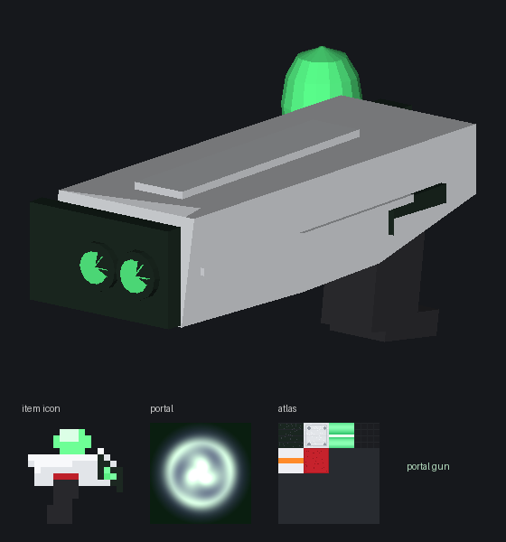
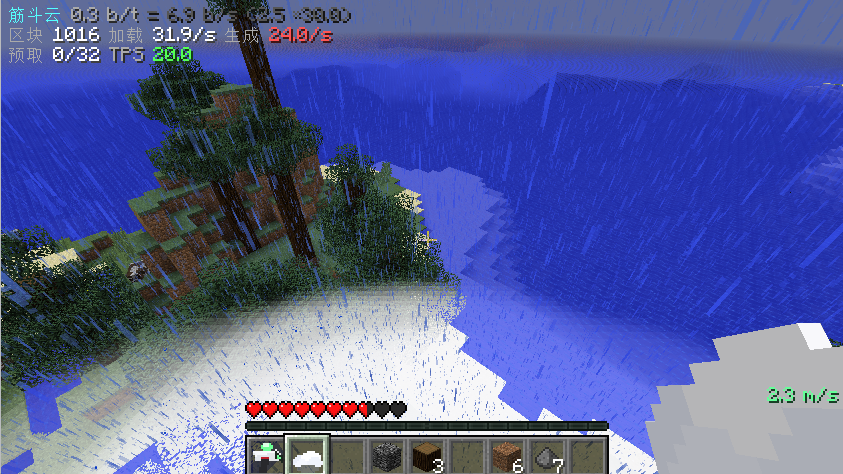

# Hbm's Nuclear Tech Mod —— 带传送枪的分支

这是 [HbM 的 NTM](https://github.com/HbmMods/Hbm-s-Nuclear-Tech-GIT) 的一个 fork，玩着玩着觉得
“缺一把传送枪”和“核爆能不能别把主线程卡死”，就顺手加上了，另外补了一套 1.7.10 开发环境的热重载脚本。

上游的内容（物品、机器、配方、世界生成）基本没动，新东西都是加在旁边的。

---

## 新增的物品

### 传送枪 / Portal Gun



右键对着方块开一枪，墙上（或者地上、天花板上）就会出现一个绿色的传送门；再对着别处开一枪，
第二个门会从另一头出来，两个门自动连通。走进去就从另一个门出来。

蹲下右键可以把这一对门收掉。

几个细节：

- 六个面都能贴，包括天花板和地板。打在地板上的门是平躺的，可以直接跳进去
- 打在高草、花、雪这类没有碰撞的方块上，会自动落到下面的实地上，不会浮在半空
- 穿过门的时候速度是保留的：进去多快，出来就多快，方向按两个门的朝向旋转过去，
  法向分量会反过来（朝门面飞进去，就从另一个门面飞出来）
- 走进去、掉进去、被其他东西撞进去都算，不需要特地加速或者跳跃
- 传送后两秒内免疫摔落伤害，所以可以拿它当高空缓冲
- 门自己只能活两分钟，超时会自动关闭，不会在世界里留垃圾

合成（1.7.10 工作台）：

```
枪金属板   末影珍珠   枪金属板
枪金属机构  玻璃     枪金属机构
           钢块
```

拿着枪的时候，屏幕右下角会显示当前速度（m/s），循环穿门的时候能看到数字一路往上跳。

### 筋斗云 / Jindou Yun
右键召唤一朵云并骑上去，再右键一次就下来、云也收走。

- `WASD` 转向和前进，空格上升，`Shift` 减速，`Ctrl` 加速
- 骑乘时不会掉下来，也不会被摔伤
- 暂时没有合成表，创造模式物品栏（导弹页）或者 NEI 里能找到
### 改了一些参数
soyuzLauncher dont need wait launch time now,and SatellitePrecisionLaser and EntityDeathBlast removed charing time and imporved blast range and damage.let's see are these changes are your loving things>_<?.<br>
顺带做了一些优化,现在筋斗云开最快(**1500m/s!!**)卡顿也可以接受了,不过还是有一些bug.but whatever,who cared?it just run.<br>
add a hud so you can see your speed,mspt,tps now<br>
and i also optimized saving world time and load chuck function,it's why jindouyun's fast speed mode is useable,i think whatever you are playing vanilla or hyper version this will be a special experience,but of course it's not same as Distant Horizons or other optimization mod.<br>
最重要的更新!!添加了`/ntmsatellites give` command,so you can get back your lost stallite now but without complex terminal command process.actually,that terminal is bad,it even cant remenber what command you type in at last.how to use?just use `/ntmsatellite list` get id of satellite,and command `/ntmsatellites give <id>`,how simple!



## 顺带修的东西

**多线程核爆。** 上游其实已经写好了线程化的 MK5 爆炸射线追踪（`ExplosionNukeRayParallelized`），
但一直没启用，实际跑的还是老的单线程版本。启用前先修了几个问题：负责等待区块快照的队列存在竞态，
射线任务会被塞进一个没人再读的队列里，latch 永远归不了零，结果就是爆炸实体永远不消失；
空 sub-chunk 的位图也从来没清过，`destructionMap` 永远排不空。顺手把快照改成直接拷贝 12-bit 方块 id，
实测比原来逐方块建调色板快了大约 50 倍。

现在按 `hbm.cfg` 里的 `6.06_explosionAlgorithm` 选择算法（0 是旧的，1/2 是多线程），
线程起不来会自动退回旧实现，不会让整次爆炸凭空消失。

**开发工具。** `devtools/` 里是一套 1.7.10 的开发脚本：离线启动开发客户端、DCEVM 热重载
（改完代码直接替换进正在跑的游戏，不用重启）、编译监听、日志跟踪。细节写在 `devtools/HOTRELOAD.md`。

---

## 怎么构建

需要 **JDK 8**。Gradle 4.6 和 ForgeGradle 1.2 在更高的 Java 上跑不起来,构建是否成功和网络强相关,第一次构建完应该就可以使用`--offline`参数离线构建
```bash
JAVA_HOME=/usr/lib/jvm/java-8-openjdk ./gradlew setupDecompWorkspace   # 第一次需要，反编译要几分钟
JAVA_HOME=/usr/lib/jvm/java-8-openjdk ./gradlew build                  # 产物在 build/libs/
```

想直接开开发客户端：

```bash
./devtools/run-client.sh
```

运行目录是 `eclipse/`，存档、配置、日志都在里面。改了代码想热重载的话，
另开一个终端跑 `./devtools/hot-reload.sh`。

> 注意：`./gradlew jar` 会重写客户端正在加载的那个 jar，游戏开着的时候打包会让它崩。
> 改代码优先用热重载，要打包先把游戏关掉。

---

## 已知的问题

- **射线只看得到已加载的区块**。远处没加载的地方在射线里等于空气，射程再远也打不到
- **面对面的两个门在平地上循环不起来**。落地摩擦两个格就把水平速度吃光了，想跑循环请把门建在空中，
  或者让两个门有高度差
- **速度太快会穿方块**。超过大约 10 格/tick 之后，一 tick 跨过好几个方块，碰撞检测会漏
- 传送门刚出来的两秒内不会再次触发（防止来回弹），这是故意的

---
## 关于模型
欢迎给mod添加更好看的模型<br>
but actually,i think this mod will not be popular,maybe these models will stay here for ever

## 分支与许可

`master` 和 `portal-gun` 是同一个提交，随便切。上游分支原样保留，需要的话从 `origin` 拉。

模组本体是 HbMinecraft 和各位贡献者的，完整名单在 `gradle.properties` 和上游仓库里。
这个 fork 只跑在上面加了上面提到的这些东西。许可证跟上游一致：见 `LICENSE` 和 `LICENSE.LESSER`。

更详细的改动记录在 [CHANGES.md](CHANGES.md)。
